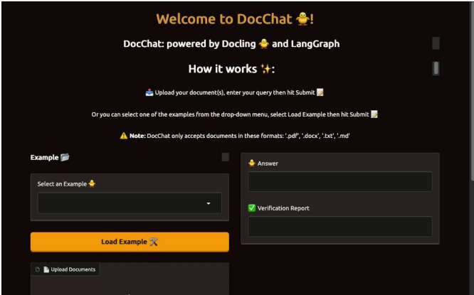
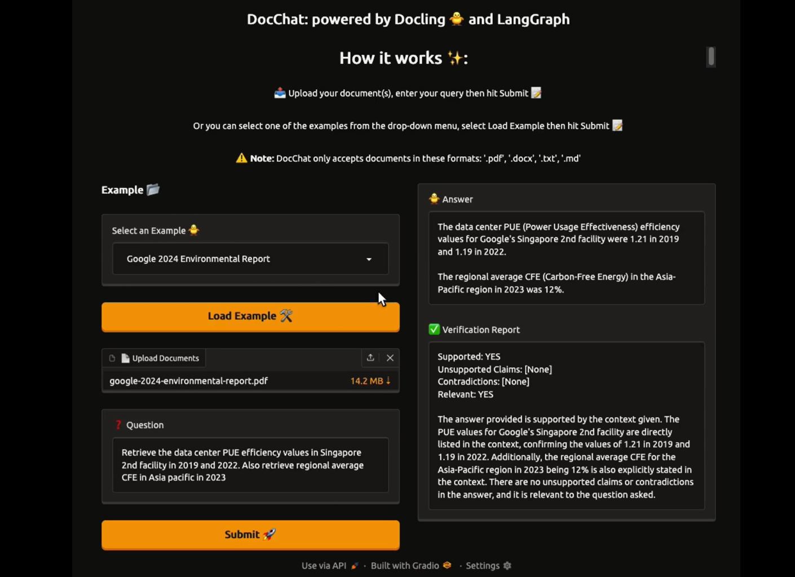
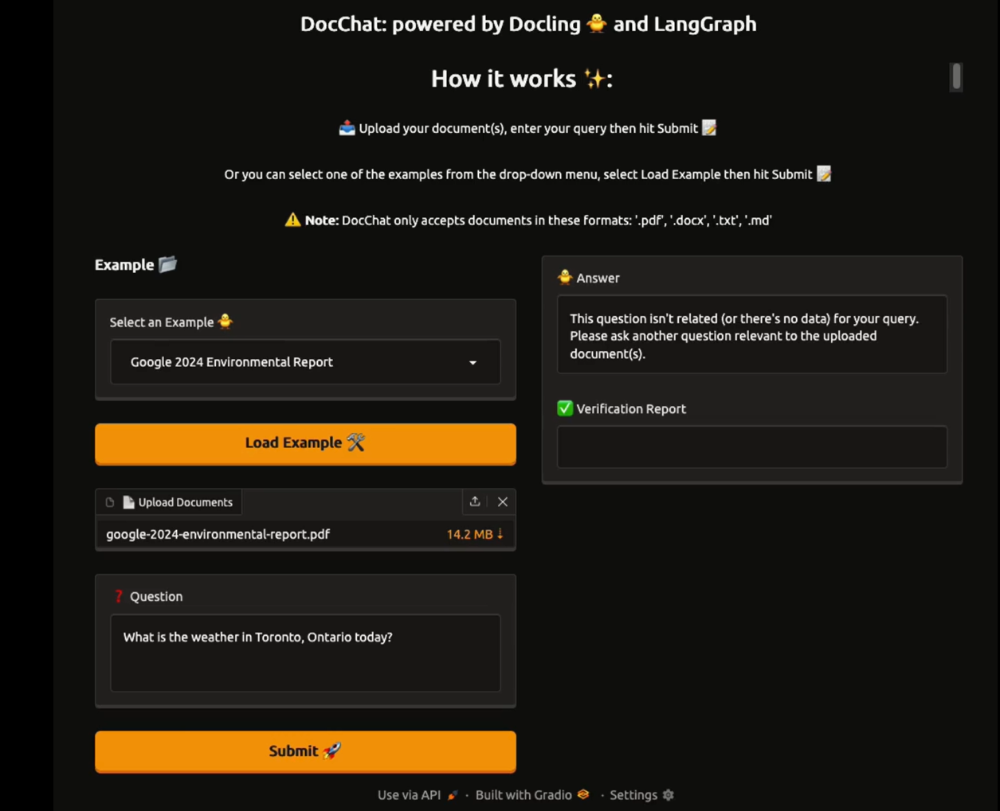
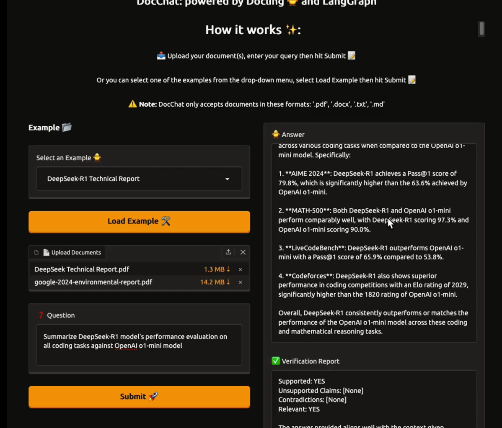

# **DocChat**

## **📄 Overview**

DocChat is a multi-agent Retrieval-Augmented Generation (RAG) system that extracts precise, verifiable answers from long, complex documents (PDF, DOCX, TXT, MD). It uses document-aware parsing (Docling), a hybrid retriever (BM25 \+ vector search), and a LangGraph multi-agent workflow (relevance check → research → verification → self-correct) to produce source-backed, hallucination-resistant answers optimized for tables, figures, scanned pages, and dense text.

---

## **✨ Features**

* **Hybrid retrieval**: BM25 lexical search combined with Chroma vector search for robust passage selection  
* **Accurate parsing**: Docling converts files to structured Markdown and extracts tables; supports OCR for scanned PDFs  
* **Multi-agent workflow**:  
  * **Relevance Checker** to detect in-scope vs out-of-scope queries  
  * **Research Agent** to synthesize draft answers from retrieved context  
  * **Verification Agent** to validate answers and produce a structured verification report  
  * **Self-correction loop** to re-run research when unsupported claims or contradictions are detected  
* **Persistent vector store**: ChromaDB for fast similarity search and session reuse  
* **Web UI**: Gradio interface for uploading docs, entering questions, and viewing verification reports  
* **Examples**: Preloaded documents and sample queries for quick demos

---

## **🧰 Tech Stack**

* **Language**: Python 3.11  
* **Document parsing**: Docling (Markdown extraction, table handling, OCR)  
* **Workflow orchestration**: LangGraph  
* **RAG glue**: LangChain-style patterns; BM25 retriever; ChromaDB vector store  
* **Embeddings & models**: IBM watsonX AI (embeddings \+ inference for research and verification agents)  
* **Frontend**: Gradio

---

## **🚀 Installation**

1. Clone and checkout the release branch:

   * git clone \--no-checkout https://github.com/punyatoya-github/DocChat.git docchat  
   * cd docchat  
   * git checkout 2-final  
2. Create and activate a Python 3.11 virtual environment:

   * python3.11 \-m venv venv  
   * source venv/bin/activate  
3. Install dependencies:

   * pip install \-r requirements.txt

Notes:

* Accepted file formats: **.pdf**, **.docx**, **.txt**, **.md**  
* Do not commit credentials; keep them in environment variables or a local .env (provide .env.example if needed)

---

## **▶️ Usage**

1. Start the Gradio app:

   * python app.py  
2. Open the application. From the UI you can:

   * Upload one or more documents  
   * Enter natural-language questions about uploaded files  
   * Load provided example datasets and queries  
   * View the generated answer and the verification report  
3. Key runtime behavior:

   * Docling parses uploads into structured Markdown and chunks them for retrieval  
   * Hybrid retriever (BM25 \+ Chroma vector search) is built and cached per session using SHA-256 file hashing  
   * LangGraph orchestrates relevance → research → verify → self-correct  
   * Final answer and verification report are displayed in the UI

Tips:

* If you edit uploaded documents, the system will detect changes and rebuild the retriever automatically  
* Stop the server with Ctrl+C

---

## **✅ Testing the application**

* Unit and integration test targets:  
  * DocumentProcessor: structured Markdown & table extraction; OCR for scanned PDFs  
  * RetrieverBuilder: BM25 and vector top-k correctness and weighting behavior  
  * LangGraph workflow: CAN\_ANSWER / PARTIAL / NO\_MATCH routing and self-correction loops  
  * VerificationAgent: structured verification output parsing (Supported, Unsupported Claims, Contradictions, Relevant)  
* Manual test checklist:  
  * Load an example document and submit an in-scope question; confirm Supported: YES  
  * Submit an out-of-scope question; confirm NO\_MATCH and no hallucinated answer  
  * Alter a source passage, re-run the query, and observe unsupported claim detection or self-correction  
* Performance considerations:  
  * Measure BM25 vs vector latencies and tune HYBRID\_RETRIEVER\_WEIGHTS  
  * Monitor model inference times; large models may require timeouts, retries, or smaller alternatives

---

## **🗂️ Folder structure**

Use this tree-style layout when organizing the repository:

docchat/  
 │── app.py \# Main application script (Gradio \+ pipeline orchestration)  
 │── requirements.txt \# Project dependencies  
 │── README.md \# Project documentation  
 │── CONTRIBUTING.md \# Contribution guidelines  
 │── .gitignore \# Ignored files and folders  
 │── venv/ \# Virtual environment (ignored in .gitignore)  
 │  
 │── agents/  
 │ ├── research\_agent.py \# Research Agent implementation  
 │ ├── verification\_agent.py \# Verification Agent implementation  
 │ └── relevance\_checker.py \# Relevance checking logic  
 │  
 │── document\_processor/  
 │ ├── file\_handler.py \# Docling integration and file parsing  
 │ └── processor.py \# DocumentProcessor wrapper and chunking logic  
 │  
 │── retriever/  
 │ ├── builder.py \# Hybrid retriever builder (BM25 \+ Chroma)  
 │ └── bm25\_retriever.py \# BM25 retriever helper  
 │  
 │── workflow/  
 │ ├── workflow.py \# LangGraph StateGraph wiring  
 │ └── agent\_workflow.py \# AgentWorkflow wrapper and entry points  
 │  
 │── config/  
 │ ├── settings.py \# App settings and constants  
 │ └── logging.conf \# Logging configuration  
 │  
 │── document\_cache/ \# Cached parsed chunks and pickles (gitignored)  
 │  
 │── utils/  
 │ ├── hashing.py \# SHA-256 file hashing utilities  
 │ └── helpers.py \# Misc helper functions  
 │  
 │── examples/  
 │ ├── google-2024-environmental-report.pdf  
 │ └── DeepSeek-R1-Technical-Report.pdf  
 │  
 │── screenshots/  
 │ ├── ui-upload.png  
 │ ├── answer-verification.png  
 │ └── multi-document.png

Notes:

* Add large or transient files to .gitignore (document\_cache, venv)  
* Provide a .env.example for required environment variables (e.g., watsonx credentials) and do not commit secrets

---

## **🖼️ Screenshots**

* UI landing page with upload controls and examples dropdown (screenshots/ui-upload.png)
  
  

  
* Example query and generated answer with verification (screenshots/answer-verification.png)
  
  

  
* Answer showing unrelated questions from user (screenshots/unrelated-question.png)
  
  

  
* Multi-document retrieval demo showing correct source selection (screenshots/multi-document.png)
  
  

---

## **👥 Authors**

Punyatoya Mohanty

---

## **📜 License**

This project is licensed under the Punyatoya Mohanty’s Non-Commercial License. See the [LICENSE](LICENSE.md) file for details.

---

